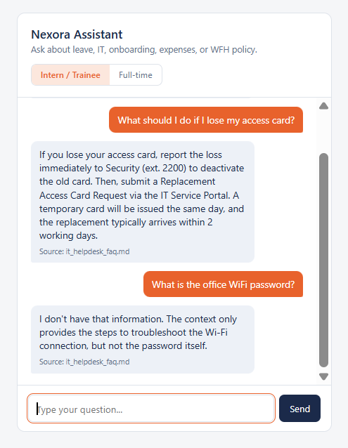
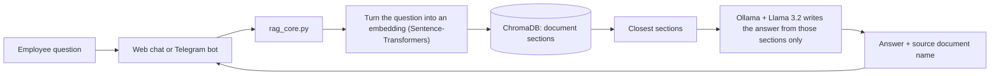

# Nexora Assistant

**An AI onboarding assistant for new interns and trainees.** They ask a question in plain English, on a web page or in Telegram, and get a short answer based on the company's documents, with the source named. It runs on a local machine: the AI model and the search database need no paid API.



> **About the data:** this is a prototype built as an end-of-internship Initiative project. Every document in `documents/` is a **fictional** sample policy for a made-up company. No real company data is included.

## The problem

Every new intake of interns and trainees asks the same questions in the first weeks: how many leave days they get, what the working hours are, how to connect to the VPN, who to call for IT problems. The answers are spread across several documents, so people end up asking HR or IT directly, and HR and IT answer the same questions again and again.

## What it does

- **Finds the right information** using semantic search, which matches by meaning, not only by keywords.
- **Writes a short, clear answer** from the retrieved text only, and names the source document.
- **Answers for the right person.** Interns/trainees and full-time staff have different rules, so the answer depends on the selected role.
- **Does not guess.** If the answer is not in the documents, it says "I don't have that information".
- **Works on two channels** with the same brain: a web chat page and a Telegram bot.

### Example questions

| Question | Role | What the assistant does |
|---|---|---|
| How many days of annual leave do I get? | Intern / Trainee | Answers 1 day per completed month of training |
| How many days of annual leave do I get? | Full-time | Answers 16 days per year |
| What should I do if I lose my access card? | Any | Gives both steps: report it to Security first, then request a replacement |
| What is the office WiFi password? | Any | Says it does not have that information (it is not in any document) |

## How it works

This is a Retrieval-Augmented Generation (RAG) pipeline:



1. **Indexing (`ingest.py`, run once):** each document is split into sections by its `##` headings. Each section is turned into an embedding and stored in ChromaDB.
2. **Retrieval:** the question is embedded the same way, and the closest sections are found. The closest match is always used. Extra matches are used only if they are also close, so the cited sources are honest.
3. **Generation:** Llama 3.2, running locally in Ollama, writes the answer using only those sections and the user's role.
4. **Reply:** the answer is sent back with the name of the source document.

## Test results

`evaluate.py` runs 12 test questions through the real pipeline: 10 that have an answer in the documents and 2 that must be refused.

| Metric | Result |
|---|---|
| Retrieval accuracy (the right document was found) | **100%** (10/10) |
| Answer accuracy (the key fact is in the answer) | **90%** (9/10) |
| Hallucination avoidance (it admits it does not know) | **100%** (2/2) |
| Average response time (on a laptop CPU) | about 4 to 6 seconds |

Testing found real problems that were then fixed:

- **Retrieval went from 80% to 100%** after documents were split into sections. Before that, one question pulled an incomplete document and the assistant gave a wrong answer.
- **A missing safety step was fixed.** The assistant skipped "report the lost card to Security" until the prompt was changed to require every step of a process.
- **Citations were made honest.** It used to list a second document that had not been used.

## Tech stack

| Part | Tool |
|---|---|
| Search | Sentence-Transformers (`all-MiniLM-L6-v2`) and ChromaDB |
| Answer generation | Ollama with Llama 3.2 (3B), running locally |
| Backend | Python and Flask |
| Web page | HTML, CSS and JavaScript |
| Telegram | Telegram Bot API, using plain HTTPS long polling |
| Testing | A custom evaluation script with 12 test cases |

## Getting started

You need Python 3.10 or newer (developed on Python 3.14), [Ollama](https://ollama.com), and roughly 5 GB of free disk space.

```bash
# 1. Create and activate a virtual environment
python -m venv venv
venv\Scripts\activate            # Windows
# source venv/bin/activate       # macOS / Linux

# 2. Install the packages
pip install -r requirements.txt

# 3. Download the AI model (about 2 GB, needs internet once)
ollama pull llama3.2

# 4. Build the search index from the documents
python ingest.py
```

### Run the web app

```bash
python app.py
```

Open http://127.0.0.1:5000, choose Intern / Trainee or Full-time, and ask a question. The first answer can take longer while the model loads.

### Run the Telegram bot

1. In Telegram, open **@BotFather**, send `/newbot`, and copy the token it gives you.
2. Create a file named `.env` next to `telegram_bot.py` with one line (no quotes, no spaces):
   ```
   TELEGRAM_BOT_TOKEN=your_token_here
   ```
3. Start the bot:
   ```bash
   python telegram_bot.py
   ```
4. Open your bot in Telegram and send `/start`. Use the two buttons to switch between Intern / Trainee and Full-time.

The bot only replies while this script (and Ollama) is running on your computer. Never commit the `.env` file. It is already listed in `.gitignore`.

### Run the tests

```bash
python evaluate.py
```

The results are saved in `results.csv`.

## Project structure

```
app.py              Flask web server
templates/          the web chat page
rag_core.py         search and answer logic, shared by the web app and the bot
ingest.py           builds the search index from documents/
telegram_bot.py     Telegram channel
evaluate.py         runs the accuracy tests
test_cases.py       the 12 test questions
ask.py, answer.py   small terminal tools for debugging
documents/          fictional sample policies
docs/               screenshot used in this README
```

## Design decisions

- **Local AI model.** The model and documents stay on your machine, with no paid API and no per-question cost. This also suits internal documents that should not be sent to an outside AI service.
- **Documents split by section.** Smaller sections give more precise search results than one embedding per file.
- **Role passed into the prompt.** The same question has different correct answers for different employee types, so the assistant is told who is asking.
- **One shared core.** `rag_core.py` is used by every channel, so a fix or improvement is made once.
- **Measured, not assumed.** The test suite includes questions the assistant must refuse, to check that it does not make things up.

## Limitations

- The test set is small (12 questions) and uses fictional documents.
- The accuracy check looks for key words in the answer, so it can pass or fail an answer because of wording. AI wording can also vary slightly between runs.
- Messages sent through Telegram pass through Telegram's servers, even though the AI model and documents stay local.
- The Telegram bot remembers each user's role only while it is running, and it handles one message at a time. This is fine for a small pilot, not for many users.
- Anyone who finds the bot's username can message it. Add access control before using real documents.

## Roadmap

- Pilot with one intake of new interns and collect feedback.
- Connect the same backend to WhatsApp, the channel most staff use every day.
- Add access control, and save each user's role between restarts.
- Grow the test set and use approved real documents.

## Author

Lama M. R. Siam, Software Engineering student at Multimedia University. GitHub: [lamasiam](https://github.com/lamasiam)
